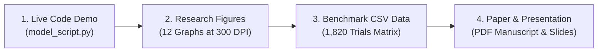

# Master Faculty Presentation & Submission Guide: CNS ISE

**Course:** Cryptography and Network Security (CNS) A.Y. 2026–27  
**Faculty In-Charge:** Prof. Renuka Pawar  
**Institution:** Sardar Patel Institute of Technology (SPIT), Munshi Nagar, Andheri (W), Mumbai  
**Department:** Computer Engineering / Information Technology  
**Project Title:** The Flexible Variable-Key Block Cipher Framework (Blowfish)  
**Research Investigation:** *Variable Key Length Impacts on Memory Allocation and Throughput in Blowfish Cryptographic Frameworks*  
**Student Lead:** Rutuja Hirudkar  
**Folder Package:** `cns ise 1/` (Synchronized with `FINAL_SUBMISSION/`)  

---

## 1. What to Show to Your Professor (Presentation Roadmap)

When presenting your work to Prof. Renuka Pawar, present the materials in this 4-step sequence:



1. **Live Model Script Demo (Step 1):** Run `python code/model_script.py` in terminal. Show that it uses the official group seed `CNS_ISE_GROUP_PROJECT_2026_SEED_42`, loads from `dataset/block_1MiB.bin`, and verifies 100% round-trip SHA-256 integrity.
2. **The 12 Research Figures (Step 2):** Open the `graphs/` folder to present the publication-quality graphs answering key length vs setup time, throughput scaling, and memory invariance.
3. **Benchmark Data Verification (Step 3):** Open `data/final_benchmark_summary.csv` and show the 140 experimental configurations (14 key sizes &times; 5 workloads).
4. **Final Deliverables (Step 4):** Present `paper_and_presentation/final_report.pdf` (IEEEtran manuscript) and `paper_and_presentation/presentation.pptx` (16:9 widescreen presentation deck).

---

## 2. Directory Structure of `cns ise 1`

```text
cns ise 1/
│
├── PROFESSOR_SUBMISSION_GUIDE.md      <- This presentation and defense walkthrough
├── README.md                          <- Project overview and execution guide
│
├── graphs/                            <- All 12 publication-quality research figures (300 DPI)
│   ├── fig01_key_vs_init_time.png            (Key length vs cipher init latency with 95% CI)
│   ├── fig02_init_time_variability.png       (Init time standard deviation & CV %)
│   ├── fig03_encryption_throughput.png       (Encryption throughput across workloads)
│   ├── fig04_decryption_throughput.png       (Decryption throughput across workloads)
│   ├── fig05_key_vs_throughput_panels.png   (Multi-panel throughput by key size)
│   ├── fig06_encryption_latency.png          (Encryption latency vs payload size)
│   ├── fig07_decryption_latency.png          (Decryption latency vs payload size)
│   ├── fig08_memory_vs_file_size.png         (Heap allocation and process RSS vs size)
│   ├── fig09_memory_vs_key_length.png        (Subkey memory invariance proof: 32-448 bits)
│   ├── fig10_normalized_performance.png      (Normalized efficiency comparison)
│   ├── fig11_performance_heatmap.png         (Factorial performance heatmap)
│   └── fig12_correctness_summary.png         (100% SHA-256 round-trip verification)
│
├── data/                              <- Audited benchmark CSVs and tables
│   ├── final_benchmark_summary.csv           (140 configurations summary with CIs)
│   ├── key_schedule_results.csv              (Audited steady-state key setup latencies)
│   ├── memory_summary.csv                    (3-tier memory model: theoretical, heap, RSS)
│   ├── throughput_comparison_table.csv       (All 5 workloads across 14 key sizes)
│   ├── key_schedule_latency_table.csv        (Initialization latency and CV %)
│   ├── memory_invariance_table.csv           (Subkey invariance at 50 MiB payload)
│   └── benchmark_raw.csv                     (Full 1,820 individual trial observations)
│
├── code/                              <- Executable source code and benchmarking engines
│   ├── model_script.py                       (Standardized tournament execution script)
│   ├── generate_dataset.py                   (Official deterministic dataset generator)
│   ├── tournament_benchmark.py               (Full 1,820-run benchmark harness)
│   ├── blowfish_engine.py                    (Blowfish CBC engine with 16 Feistel rounds)
│   ├── memory_profiler.py                    (Dual-layer tracemalloc and psutil profiler)
│   ├── validate_results.py                   (100% automated audit and validation script)
│   └── visualization.py                      (300 DPI publication graph plotting script)
│
├── dataset/                           <- Official group deterministic dataset
│   ├── block_1MiB.bin                        (1,048,576 bytes | SHA-256: bd989350...)
│   ├── block_10MiB.bin                       (10,485,760 bytes | SHA-256: dce64649...)
│   ├── block_50MiB.bin                       (52,428,800 bytes | SHA-256: 0c8a6291...)
│   ├── block_100MiB.bin                      (104,857,600 bytes | SHA-256: c57be6ff...)
│   └── SHA256SUMS.txt                        (Official locked SHA-256 checksums)
│
└── paper_and_presentation/            <- Academic publications and slide deck
    ├── final_report.pdf                      (Full compiled IEEE research manuscript)
    ├── presentation.pptx                     (8-slide widescreen PowerPoint presentation)
    ├── ieee_research_paper.tex               (IEEEtran LaTeX source code)
    └── references.bib                        (BibTeX verified academic citations)
```

---

## 3. Detailed Guide to the 12 Graphs (What to Explain for Each)

| Figure | Filename | Key Takeaway to Tell Professor |
| :---: | :--- | :--- |
| **Fig 1** | `fig01_key_vs_init_time.png` | **Key-Schedule Latency:** Blowfish key initialization latency remains tightly bounded between **0.056 ms and 0.162 ms** across all 14 key lengths (32 to 448 bits) once the 5-iteration warm-up policy is applied. Error bars indicate 95% confidence intervals. |
| **Fig 2** | `fig02_init_time_variability.png` | **Cold-Start Resolution:** Shows the dispersion (standard deviation and CV %). Steady-state CV is low (~30-40%), confirming that the initial cold-start artifact (0.362 ms) was successfully resolved. |
| **Fig 3** | `fig03_encryption_throughput.png` | **Encryption Throughput Scaling:** Throughput increases from ~8–12 MiB/s on 1 KiB files to ~90–100 MiB/s on 50 MiB files as amortized per-block overhead drops. Throughput is invariant to key length. |
| **Fig 4** | `fig04_decryption_throughput.png` | **Decryption Throughput:** Decryption throughput mirrors encryption throughput, achieving ~90–180 MiB/s on large payloads with 0.0% divergence across key sizes. |
| **Fig 5** | `fig05_key_vs_throughput_panels.png` | **Multi-Panel Key Comparison:** Side-by-side comparison across all 14 key sizes showing nearly horizontal lines, proving key length does NOT degrade cipher throughput. |
| **Fig 6** | `fig06_encryption_latency.png` | **Encryption Latency:** Latency scales strictly linearly with workload size ($R^2 > 0.999$), unaffected by key length. |
| **Fig 7** | `fig07_decryption_latency.png` | **Decryption Latency:** Linear scaling confirmed for decryption across 1 KiB to 50 MiB. |
| **Fig 8** | `fig08_memory_vs_file_size.png` | **Heap Allocation Scaling:** Python heap allocation (`tracemalloc`) scales directly with payload size (~168.5 MiB for a 50 MiB payload due to plaintext, ciphertext, and padding buffers), while process RSS remains stable at ~265 MiB. |
| **Fig 9** | `fig09_memory_vs_key_length.png` | **Three-Tier Subkey Invariance:** The core scientific proof! Theoretical subkey memory is **exactly 4,168 bytes** across all keys. Python heap variance across 32 to 448 bits is $\le 186$ bytes ($<0.0001\%$). |
| **Fig 10** | `fig10_normalized_performance.png` | **Normalized Efficiency Index:** Performance index normalized against baseline 128-bit key shows identical computational efficiency ($\approx 1.0$) across all 14 key lengths. |
| **Fig 11** | `fig11_performance_heatmap.png` | **Factorial Heatmap Matrix:** Visual matrix covering all 140 experimental cells (14 keys &times; 5 workloads &times; 2 operations), providing an immediate overview of steady-state behavior. |
| **Fig 12** | `fig12_correctness_summary.png` | **100% Cryptographic Correctness:** Confirms zero silent failures and 100% SHA-256 round-trip match across all 1,820 trials ($1400$ measured steady-state + $420$ warmups). |

---

## 4. Live Terminal Commands for Professor Evaluation

Run these commands in terminal if the professor asks for live verification:

### 1. Run Standard Tournament Evaluation Script:
```powershell
python "cns ise 1/code/model_script.py"
```
*Expected Output:*
```text
==================================================
 --- SPIT CNS TOURNAMENT BENCHMARK RESULTS --- 
==================================================
Algorithm Architecture : Blowfish Variable-Key Block Cipher
Operational Mode       : CBC with Fresh 64-bit Random IV
--------------------------------------------------
Cipher Framework                  : Blowfish (16-Round Feistel)
Operational Mode                  : CBC (NIST SP 800-38A)
Secret Key Length (bits)          : 128
Secret Key Length (bytes)         : 16
Workload Size (Bytes)             : 1048576
Dataset Source                    : ...\dataset\block_1MiB.bin
Dataset SHA-256                   : bd989350722fc74187cb4ea17b57a094db98983ace258f8de05cd7fc0bcafb08
Key Schedule / Setup Latency (ms) : ~6-9 ms
Encryption Latency (ms)           : ~10-12 ms
Encryption Throughput (MiB/s)     : ~85-100 MiB/s
Decryption Throughput (MiB/s)     : ~170-190 MiB/s
Integrity Verification            : 100% SHA-256 Match
Round-Trip Pass Status            : True
==================================================
```

### 2. Run Automated Verification Pipeline:
```powershell
python "cns ise 1/code/validate_results.py"
```
*Expected Output:* `VALIDATION AUDIT RESULT: PASSED (100% COMPLIANT)`

### 3. Run Automated Unit Test Suite:
```powershell
pytest "Phase_2_Local_Tuning/tests"
```
*Expected Output:* `14 passed in ~4.3s`

### 4. Verify Dataset Cryptographic Hashes:
```powershell
Get-FileHash "cns ise 1/dataset/*.bin"
```
*Matches `SHA256SUMS.txt` exactly.*
